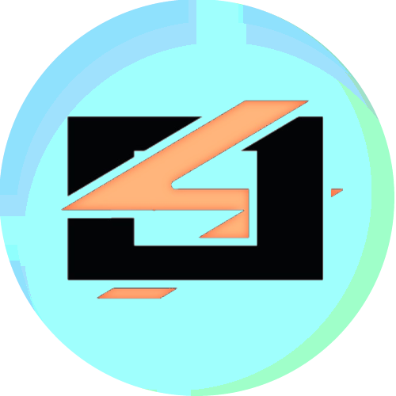

<p align="center">
  
</p>

# B3JS Game Engine

> **The Next-Generation Web3-Native 3D Engine.**
> High-performance, modular, and built for the decentralized world.

---

## 🚀 Overview

B3JS is an industrial-grade, browser-based 3D game engine and editor built on **Three.js** and **Cannon-es**. It is designed for maximum developer leverage, focusing on **Web3 integration**, **Real-time Multiplayer (SpacetimeDB)**, and **Sandboxed Python logic**. 

From high-fidelity tactical simulations to decentralized virtual worlds, B3JS provides a professional suite of tools including a Nodal Material System, Logic Brick Framework, and comprehensive state restoration.

## ✨ Key Features

- **🛡️ Phase 4 Engine Stabilized**: Pure ECS separation. WebWorkers handle intensive pathfinding and AI updates independently, ensuring stable 60+ FPS under heavy logic load. Safe serialization stops Editor Play/Pause data bleeding.
- **🔐 Zero Knowledge Privacy Infrastructure**: Cryptographically secured multiplayer state including Fog of War overlays, dynamic ZK privacy zones, Sealed Bid inventory mechanics, and AES-GCM encrypted peer-to-peer chat.
- **🌐 Multiplayer Sync (SpacetimeDB)**: Granular, real-time synchronization of world state. The networking subsystem employs strict Ownership schemas to completely prevent unauthorized remote state manipulation.
- **🐍 Python & C# Scripting**: Sandboxed behavior logic powered by **Pyodide** and dynamic C# execution contexts.
- **🦴 Dynamic Skeleton & Procedural IK**: Native extraction of `THREE.Bone` hierarchies from GLTF imports. Logic Bricks like `BoneLookAtActuator` provide dynamic procedural aiming, head tracking, and IK recoil out-of-the-box.
- **🥽 XR Locomotion Ready**: Hardcoded index limitations resolved with dynamic dominant-handedness detection and patched memory leaks for seamless headset experiences.
- **📏 Dynamic XR Scale System**: Advanced two-handed "grip-and-stretch" gestures for scaling both objects and the user (World Scale). Includes a **High-Precision Mode** (0.1x damping) and proportional locomotion scaling.
- **🎙️ Proximity Voice & Secure Communications**: Integrated WebRTC spatial audio system using `THREE.PositionalAudio`. Includes multiple mic modes (Proximity, Broadcast, Zone, PTT) completely secured with AES-GCM encrypted WebRTC signaling via SpacetimeDB.
- **🎙️ AI Voice & Spatial Intent**: Integrated NLP engine for processing deictic and spatial commands. Commands like "spawn this here" or "delete that" use real-time raycasting and spatial context to map intent to world actions.
- **🎨 Nodal Material Editor**: A visual-ready shader graph system for creating complex, dynamic materials and effects.

- **🧩 Advanced Logic Bricks**: Professional-grade behavioral system (Sensors, Controllers, Actuators) with expanded support for Web3 wallets, Mining telemetry, and the new **Swap Scale** exchange system.
- **⚡ Custom Asset Pipelines**: Support for dynamic, remote asset manifests. Users can register custom JSON-based asset banks via URL, which persist across sessions and automatically merge with the core engine registry.
- **🛠️ Professional Editor Tools**: 
    - **Modernized AssetBank**: Nodal-style accordion interface for high-density asset management and rapid search.
    - **XR Spatial Outliner**: Interactive 3D "Bolt Tablet" for in-scene management, projecting the hierarchical Outliner into 3D space.
    - **⚡ Spatial Duplication**: Deep-cloning system for 3D assets and logic nodes, complemented by a floating XR toolbar for rapid manipulation.

    - **Undo/Redo** history and state restoration.
    - Transform Gizmos for precise object manipulation.
    - Specialized panels for Networking, Optimization, Audio, and Inventories.

## 🛠️ Tech Stack

- **Core**: TypeScript, Three.js, Cannon-es
- **Multiplayer**: SpacetimeDB
- **Scripting**: Pyodide (Python 3.11+)
- **Build Tooling**: Bun, Vite, Turborepo
- **UI**: React-based professional editor suite
- **Web3**: EVM-compatible protocols and WalletConnect integration

## 📦 Project Structure

```text
├── apps/
│   └── web/            # The main Editor / Application entry point
├── packages/
│   ├── engine/         # Core engine (ECS, SpacetimeDB bridge, Python runtime)
│   ├── ui/             # Professional suite of Editor UI panels and components
│   └── web3/           # Web3 protocols and decentralized wallet integrations
└── assets/             # Shared geometry, textures, and avatar assets
```

## 🚀 Quick Start

### Prerequisites
- [Bun](https://bun.sh/) installed on your machine.

### Installation
```bash
# Install dependencies
bun install
```

### Running the Editor
```bash
# Start the development server
bun run dev
```

### Building for Production
```bash
# Build the application
bun run build
```

## 📄 License

Internal Development Version. All rights reserved.

---

<p align="center">
  Built with ❤️ by the B3JS Team
</p>
